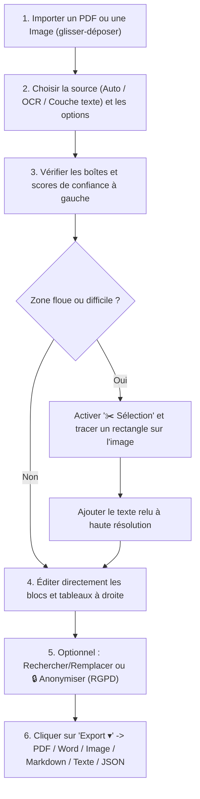

# Guide de lancement et d'utilisation — OCR Studio

Ce guide explique comment démarrer l'interface web **OCR Studio**, traiter vos documents, les éditer et les exporter.

---

## 1. Prérequis

- **Python 3.10+**
- L'environnement virtuel `.venv/` déjà configuré dans `/Users/deomimpungu/Development/ocr-studio`.
- Lors de la toute première exécution d'un OCR (si le cache Hugging Face est vide), une connexion Internet est nécessaire une seule fois pour télécharger les modèles ONNX d'Indra OCR (~76 Mo). Ensuite, tout fonctionne **100 % hors-ligne**.

---

## 2. Lancer l'interface web

Ouvrez un terminal et exécutez :

```bash
cd /Users/deomimpungu/Development/ocr-studio
.venv/bin/ocr-studio --port 8770
```

Le terminal affiche :

```text
OCR Studio démarré sur http://127.0.0.1:8770
```

Ouvrez ensuite **http://127.0.0.1:8770** dans votre navigateur (Chrome, Safari, Firefox...).

> Pour arrêter le serveur : appuyez sur `Ctrl + C` dans le terminal.  
> Pour utiliser un autre port : `.venv/bin/ocr-studio --port 9000`.

---

## 3. Flux d'utilisation pas à pas



### Détail des options (panneau de gauche)
- **Source** :
  - `Auto` : lit la couche texte des PDF numériques si elle est fiable, sinon lance l'OCR visuel.
  - `OCR` : ignore la couche texte et lit toute la page visuellement.
  - `Couche texte` : force la lecture de la couche texte PDF.
- **Haute précision FR / Tableaux** *(activé par défaut)* : fusionne les cellules multi-lignes des tableaux, raccorde les tableaux coupés entre deux pages et corrige les majuscules accentuées / mots composés français.
- **Scan difficile (CLAHE)** : améliore le contraste et réduit le bruit sur les vieux scans.
- **Photo téléphone (ombres)** : supprime les ombres et uniformise le fond blanc sur les documents photographiés au smartphone.
- **Math en LaTeX** : active la reconnaissance des formules mathématiques au format `$...$`.
- **DPI (`150` / `200` / `300`)** : passez à `300` pour les documents avec de très petits caractères.

### Édition directe (panneau de droite)
- **Onglet `Éditeur direct`** :
  - Modifiez le texte de chaque bloc directement dans la zone de texte.
  - Changez le type d'un bloc (`Section-Header`, `Text`, `Table`, `List-Group`, etc.).
  - Réorganisez l'ordre avec **`↑` / `↓`**, ajoutez un bloc avec **`+ Bloc`**, ou éditez les tableaux **cellule par cellule** (`+ Ligne`, `+ Colonne`).
- **Barre `Édition & RGPD`** (à gauche) :
  - **Rechercher & Remplacer** : remplace un mot/expression sur toutes les pages en un clic.
  - **`🔒 Anonymiser (RGPD)`** : masque automatiquement emails, téléphones et IBAN.
  - **`↶ Annuler`** : annule la dernière opération.

### Export
Cliquez sur le bouton **`Export ▾`** en haut à droite et choisissez :
- **PDF** : génère un PDF propre avec toutes vos modifications visibles.
- **Word** : exporte un fichier `.docx` avec titres et vrais tableaux Word.
- **Image** : exporte en `.png` (1 page) ou en archive `.zip` de `.png` (multi-pages).
- **Markdown**, **Texte**, **JSON**.

---

## 4. Lancer les tests automatisés

Pour vérifier que le moteur, le post-traitement, l'API et tous les exports fonctionnent correctement :

```bash
cd /Users/deomimpungu/Development/ocr-studio
.venv/bin/pytest -v
```
