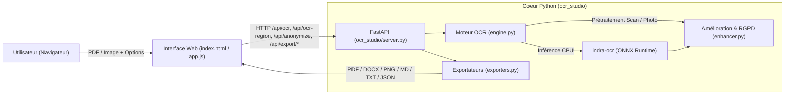
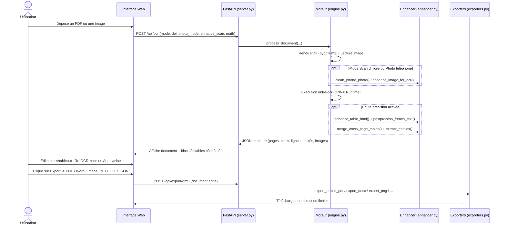

# OCR Studio

**OCR Studio** est un outil privé et local d'OCR, d'édition documentaire et d'export multi-formats basé sur `indra-ocr` (ONNX Runtime sur CPU, sans GPU ni PyTorch).

Il ajoute par-dessus le moteur de base :
- **Prétraitement adaptatif** : mode *Scan difficile* (débruitage + contraste CLAHE + accentuation) et mode *Photo téléphone* (suppression des ombres et uniformisation de l'éclairage).
- **Post-traitement haute précision** : fusion des cellules multi-lignes dans les tableaux HTML, raccordement des tableaux coupés entre deux pages, restauration des majuscules accentuées françaises (`É`, `À`, `È`...) et des mots composés.
- **Éditeur interactif côte à côte** : modification directe des blocs et des tableaux cellule par cellule (`+ Ligne`, `+ Colonne`, `↑`/`↓`, `Rechercher & Remplacer`, `Annuler`).
- **Re-OCR ciblé par zone** : sélection rectangulaire sur l'image pour relire une zone difficile en haute résolution (`upscale x2` + contraste).
- **Outils métier & RGPD** : extraction automatique de champs clés (emails, téléphones, dates, montants, IBAN) et anonymisation en un clic.
- **Exports complets** : **PDF**, **Word (`.docx`)**, **Image (`.png` / `.zip`)**, **Markdown (`.md`)**, **Texte (`.txt`)**, **JSON (`.json`)**.

---

## Architecture globale



---

## Flux de traitement (Pipeline OCR & Édition)



---

## Structure du projet

```text
ocr-studio/
├── pyproject.toml               # Dépendances et point d'entrée CLI (`ocr-studio`)
├── README.md                    # Documentation technique et architecture
├── LICENSE                      # Licence Apache-2.0
├── CONTRIBUTING.md              # Guide de contribution au projet
├── GUIDE_LANCEMENT.md           # Guide pas-à-pas de lancement et d'utilisation
├── ocr_studio/
│   ├── __init__.py
│   ├── server.py                # Serveur FastAPI, routes /api/* et encodage UTF-8 des exports
│   ├── engine.py                # Orchestration indra-ocr, rendu PDF, Re-OCR ciblé par zone
│   ├── enhancer.py              # Prétraitement photo/scan, fusion tableaux, accents FR, RGPD
│   ├── exporters.py             # Exports PDF édité, PDF searchable, Word, PNG/ZIP, CSV, MD, TXT, JSON
│   └── static/
│       ├── index.html           # Structure de l'interface (style Indra OCR)
│       ├── style.css            # Feuille de style claire (palette oklch, layout 2 colonnes)
│       └── app.js               # Éditeur de blocs/tableaux, overlays SVG, lasso Re-OCR, Undo
└── tests/
    └── test_ocr_studio.py       # Tests unitaires et d'intégration API/exports
```

---

## Démarrage rapide

Consultez le guide détaillé dans [GUIDE_LANCEMENT.md](GUIDE_LANCEMENT.md) ou lancez directement :

```bash
cd /Users/deomimpungu/Development/ocr-studio
.venv/bin/ocr-studio --port 8770
```

Ouvrez ensuite **http://127.0.0.1:8770** dans votre navigateur.

---

## Contribuer

Les contributions (correctifs, améliorations OCR, nouveaux exports, UI, documentation) sont les bienvenues. Consultez le guide [CONTRIBUTING.md](CONTRIBUTING.md) pour installer l'environnement de développement, lancer les tests (`pytest`) et soumettre une Pull Request.

---

## Auteur

Réalisé par **Deo Mimpungu**.

---

## Licence & Crédits

- **OCR Studio** est distribué sous licence **Apache-2.0** — voir [LICENSE](LICENSE).
- Le moteur OCR repose sur **[Indra OCR] (Datalab).
