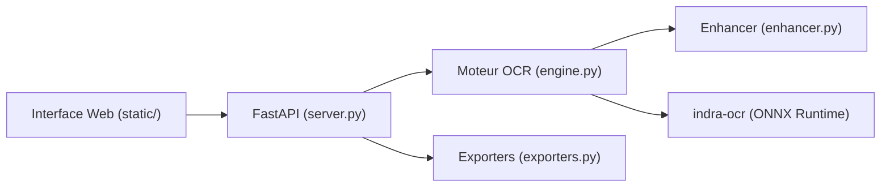

# Architecture et API

## Architecture des modules

```text
ocr_studio/
├── __init__.py
├── server.py      # Serveur FastAPI, routes /api/* et CLI `ocr-studio`
├── engine.py      # Orchestration indra-ocr, rendu PDF (pypdfium2), Re-OCR ciblé
├── enhancer.py    # Prétraitement scan/photo, post-traitement FR/tableaux, RGPD
├── exporters.py   # Exports PDF édité, PDF searchable, DOCX, PNG/ZIP, CSV, MD, TXT, JSON
└── static/
    ├── index.html # Interface web
    ├── style.css  # Feuille de style (layout 2 colonnes)
    └── app.js     # Éditeur interactif, overlays SVG, lasso Re-OCR, Undo
```



---

## Référence des endpoints API

### `GET /api/health`
Vérifie l'état du serveur.
- **Réponse** : `{"status": "ok"}`

### `POST /api/ocr`
Lance le traitement OCR complet sur un PDF ou une image (`multipart/form-data`).

| Champ | Type | Défaut | Description |
| :--- | :--- | :--- | :--- |
| `file` | `UploadFile` | *(requis)* | Fichier PDF ou image |
| `mode` | `str` | `"auto"` | `"auto"`, `"ocr"` ou `"text"` |
| `dpi` | `float` | `200.0` | Résolution de rendu PDF |
| `furniture` | `bool` | `false` | Conserver en-têtes / pieds de page |
| `math` | `bool` | `false` | Reconnaissance mathématique LaTeX |
| `enhance_scan` | `bool` | `false` | Prétraitement scan difficile (CLAHE) |
| `photo_mode` | `bool` | `false` | Prétraitement photo téléphone (ombres) |
| `postprocess` | `bool` | `true` | Post-traitement FR et tableaux |

### `POST /api/ocr-region`
Relit une zone rectangulaire précise d'une page (`application/json`).

| Champ | Type | Défaut | Description |
| :--- | :--- | :--- | :--- |
| `image_data_url` | `str` | *(requis)* | Image de la page encodée en Data URL |
| `bbox` | `list[float]` | *(requis)* | Coordonnées de la zone `[x1, y1, x2, y2]` |
| `math` | `bool` | `false` | Mode LaTeX |
| `upscale` | `float` | `2.0` | Facteur d'agrandissement |
| `enhance` | `bool` | `true` | Amélioration de contraste |
| `postprocess` | `bool` | `true` | Post-traitement texte |

### `POST /api/anonymize`
Anonymise les emails, téléphones et IBAN dans tous les blocs, lignes, textes et Markdown du document JSON fourni.

### `POST /api/export/{fmt}`
Exporte le document JSON édité dans le format demandé (`Content-Disposition` compatible UTF-8).

Valeurs acceptées pour `{fmt}` :
- `edited-pdf` : PDF généré à partir du document édité
- `pdf` : PDF searchable
- `docx` : Document Word
- `png` : Image PNG (ou archive ZIP si plusieurs pages)
- `md` : Markdown
- `txt` : Texte brut
- `csv` : Tableaux / données CSV
- `json` : JSON structuré
